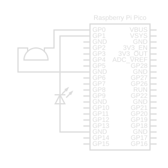

# Morse Code Translator - Version 1
A simple Morse encoder for the Raspberry Pi Pico. It reads ASCII text from a USB serial terminal, and on ENTER plays the line back as Morse code by blinking an LED and beeping a passive piezo buzzer in lock-step.

**Disclaimer:** The only time generative AI was used in the development of this project was to help me wrap my head around the PWM frequency logic for the piezo buzzer, along with some minimal code comments/documentation. Everything else is original; researched and developed without AI.

## Hardware

**Components:**
- 1x Raspberry Pi Pico (W)
- 1x Passive piezoelectric buzzer
- 1x LED (with current-limiting resistor recommended)
- 4x Jumper wires

**Wiring:**
- Piezo buzzer  -> GPIO 0, other leg to GND
- LED           -> GPIO 1, cathode to GND
- USB           -> host PC (also provides power)

## Usage
1. Build the firmware with the Raspberry Pi Pico SDK / VS Code extension and flash the resulting `.uf2` to the Pico.
2. Open the Pico's USB serial port in a terminal emulator. This project was developed and tested against **PuTTY** on Windows.
3. Type a message and press **Enter**.

## Tuning

A few `#define`s near the top of `main.c` cover the parameters you're most likely to want to change:

- `MORSE_UNIT_MS`  - base time unit; lower = faster keying.
- `PWM_WRAP`       - sets the buzzer tone frequency.
- `PWM_DUTY_CYCLE` - sets the buzzer volume (50% is loudest).
- `LED_GPIO_PIN` / `PIEZO_BUZZER_GPIO_PIN` - pin assignments.
