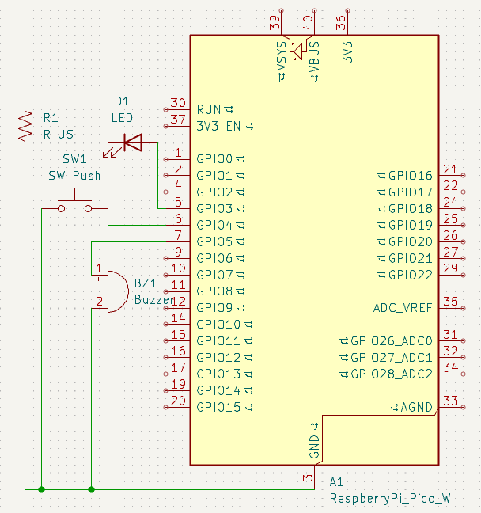

# Morse Code Translator - Version 2
A simple Morse decoder for the Raspberry Pi Pico.
Reads morse input from a button, then outputs the translated text via USB UART.

**Disclaimer:** The only area of this program where I used generative AI was to learn about Tries.

## Hardware

**Components:**
- 1x Raspberry Pi Pico (W)
- 1x Passive piezoelectric buzzer
- 1x LED (with current-limiting resistor recommended)

**Wiring:**
- GPIO 2 --> LED -----------> 220 $\Omega$ R --> GND
- GPIO 3 --> Button --------> GND
- GPIO 4 --> Piezo Buzzer --> GND

## Usage
1. Build the firmware with the Raspberry Pi Pico SDK / VS Code extension and flash the resulting `.uf2` to the Pico.
2. Open the Pico's USB serial port in a terminal emulator. This project was developed and tested against **PuTTY** on Windows.
3. If everything is connected correctly, use the button to input morse code, and you'll see the text appear in your serial monitor.

## Tuning

A few `#define`s near the top of `main.c` cover the parameters you're most likely to want to change:

- `MORSE_UNIT_MS`  - base time unit; lower = faster keying.
- `PWM_WRAP`       - sets the buzzer tone frequency.
- `PWM_DUTY_CYCLE` - sets the buzzer volume (50% is loudest).
- `LED_GPIO_PIN` / `PIEZO_BUZZER_GPIO_PIN` / `BUTTON_GPIO_PIN` - pin assignments.
